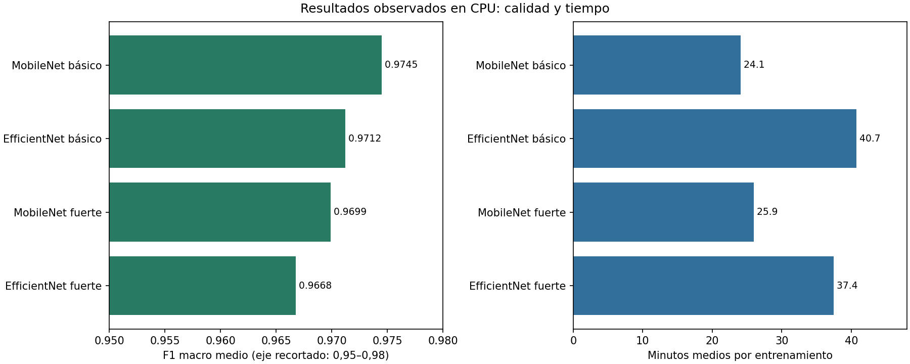
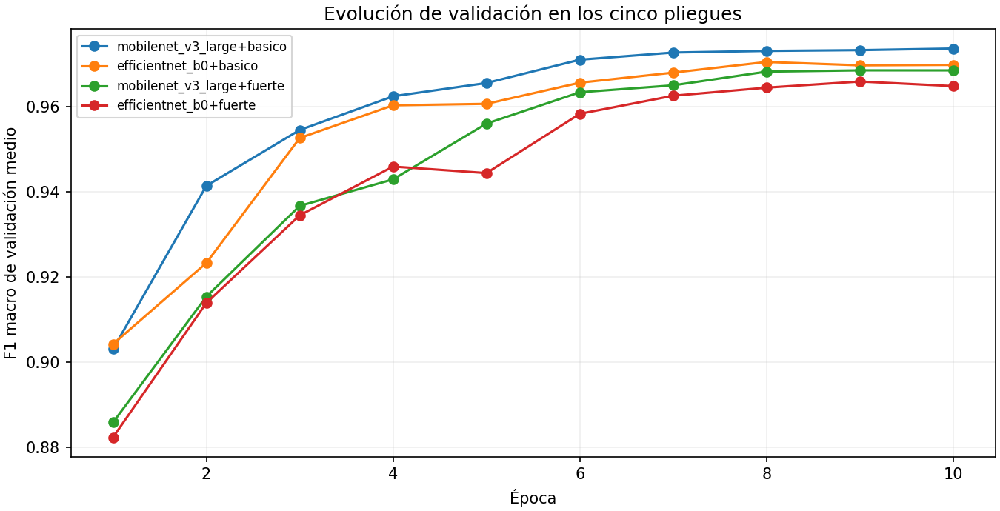
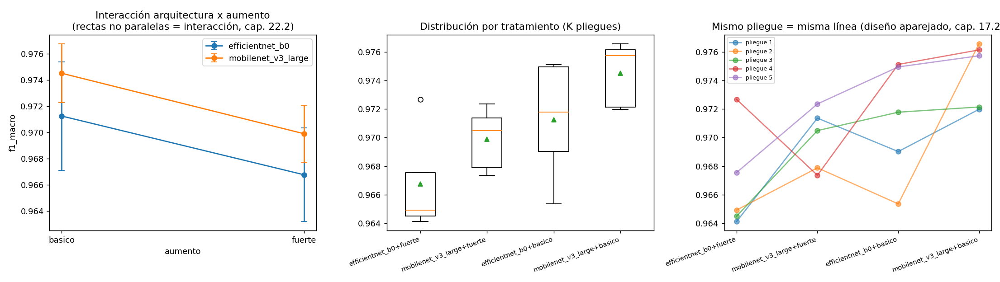
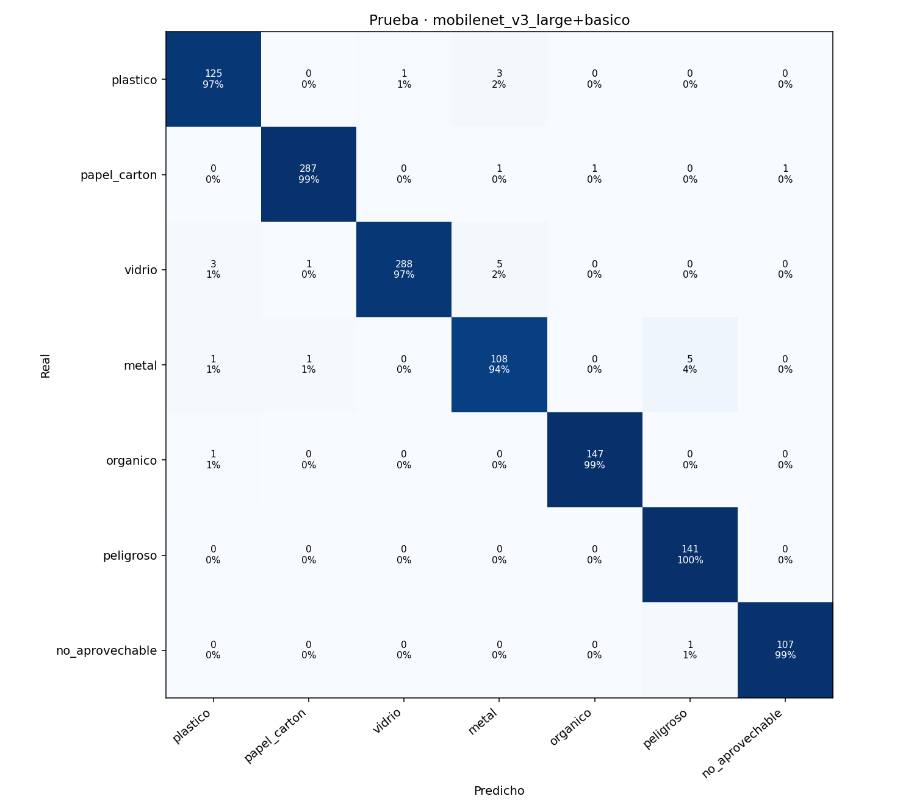
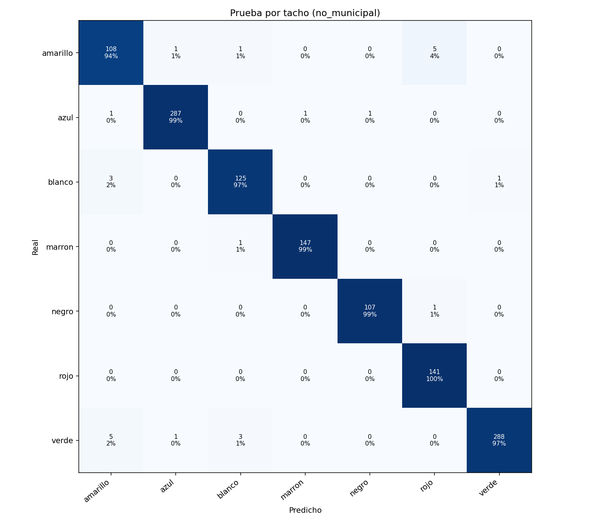
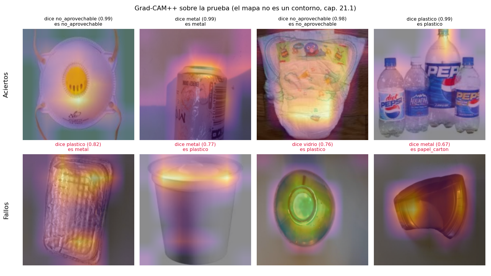

# EcoSegrega — Informe técnico de metodología y resultados

**Documento para exposición ante jurado · Fecha de corte: 29 de octubre de 2026, America/Lima.**

**Autor, institución, asignatura y docente:** completar por el expositor. No se atribuye autoría personal a partir de archivos o registros.

## 1. Resumen ejecutivo

EcoSegrega es un prototipo local en Python que clasifica fotografías de residuos en siete categorías y asigna el color de tacho definido en su catálogo. Se ejecutó un experimento factorial 2 × 2: dos arquitecturas (MobileNetV3 Large y EfficientNet-B0) y dos niveles de aumento de imágenes (básico y fuerte), con cinco pliegues compartidos por las cuatro combinaciones. Se completaron 20 entrenamientos comparativos en CPU y un entrenamiento final adicional.

**La combinación seleccionada fue MobileNetV3 Large con aumento básico**, por tener el mayor F1 macro medio de validación cruzada: **0,9745**. También fue la de menor tiempo medio registrado: **24,10 minutos por pliegue**. En la prueba reservada de 1.228 imágenes, el modelo final alcanzó **97,96 % de exactitud y F1 macro 0,9762**, con **1.203 aciertos y 25 errores**. La selección por promedio no equivale a superioridad estadística demostrada frente a todas las alternativas.

El flujo está ejecutado y el archivo del modelo existe. Los resultados corresponden a imágenes de Roboflow; no acreditan aceptación institucional, desempeño universal ni validación representativa con fotografías locales. Persisten observaciones de agrupación de imágenes y una discrepancia entre el inventario actual y la partición utilizada, explicadas en la sección 15.

## 2. Objetivo, alcance y dificultad

**Objetivo general:** comparar arquitecturas y aumentos para seleccionar un clasificador de residuos con buen desempeño y costo computacional, y generar una salida interpretable para el usuario.

**Pregunta ejecutada:** ¿cómo varía el F1 macro al cambiar entre MobileNetV3/EfficientNet y entre aumento básico/fuerte?

El repositorio también contiene una variante para estudiar fotos propias, pero **no fue la variante ejecutada**. Aquí no se comparó Perú frente a otros contextos y no se entrenó ResNet18. La dificultad académica puede describirse como intermedia–alta por la preparación, validación cruzada, controles de agrupación y análisis estadístico. Se adaptaron redes preentrenadas; no se diseñó una arquitectura nueva desde cero.

**Alcance funcional:** una imagen recibe una clase principal, confianza, tres clases más probables y tacho. La etapa de clasificación genera CSV y HTML. No implementa detección simultánea de múltiples residuos, segmentación, cámara en vivo ni control físico de tachos. Los lectores admiten datasets de detección, pero en esta ejecución se utilizó clasificación en carpetas.

## 3. Procedencia y cantidad de datos

Según el archivo local [PROCEDENCIA.json](evidencias/PROCEDENCIA.json):

- Fuente: Roboflow Universe; workspace `project-tklug`.
- Proyecto: `garbage-detection-l4ilj`, versión 1, exportación `folder`.
- Página registrada: https://universe.roboflow.com/project-tklug/garbage-detection-l4ilj/dataset/1
- Licencia consignada por la descarga: CC BY 4.0. Este informe conserva esa declaración; no constituye una auditoría de derechos de cada imagen.
- Descarga registrada: 28/10/2026 a las 19:25:27 UTC, equivalente a 14:25:27 en Lima.
- Imágenes encontradas: **8.195**; aceptadas: **8.182**; apartadas: **13**.
- Motivos registrados: 12 imágenes planas o veladas según el filtro y una etiqueta sin equivalencia, `paper_trash`. El filtro no prueba que una foto esté realmente velada; mide baja variabilidad de intensidad.

### 3.1 Correspondencia de etiquetas

| Etiquetas de origen | Clase del sistema | Tacho no municipal configurado |
|---|---|---|
| plastic | plastico | Blanco |
| paper, cardboard | papel_carton | Azul |
| brown-glass, green-glass, white-glass | vidrio | Verde |
| metal | metal | Amarillo |
| biological | organico | Marrón |
| battery | peligroso | Rojo |
| trash | no_aprovechable | Negro |

Los guiones se normalizan a guiones bajos y las etiquetas a minúsculas. El catálogo también dispone de esquema municipal, agrupando los cuatro reciclables en verde. Los colores se describen **como comportamiento configurado en el código**, no como dictamen de cumplimiento normativo. `battery` cubre baterías; no representa todos los residuos peligrosos. `trash` necesita revisión semántica por su amplitud.

### 3.2 Distribución usada realmente en el estudio

La siguiente tabla se calcula de `pliegues.csv`, cuya huella coincide con las 20 filas de resultados. Las columnas 1–5 son pliegues, no entrenamientos distintos del dataset.

| clase | 1 | 2 | 3 | 4 | 5 | prueba | Total |
|---|---|---|---|---|---|---|---|
| metal | 131 | 131 | 130 | 130 | 131 | 115 | 768 |
| no_aprovechable | 122 | 122 | 122 | 99 | 122 | 108 | 695 |
| organico | 167 | 167 | 167 | 168 | 168 | 148 | 985 |
| papel_carton | 328 | 328 | 328 | 328 | 328 | 290 | 1930 |
| peligroso | 160 | 160 | 163 | 161 | 160 | 141 | 945 |
| plastico | 147 | 146 | 146 | 149 | 146 | 129 | 863 |
| vidrio | 336 | 337 | 335 | 355 | 336 | 297 | 1996 |

Existe desbalance: vidrio y papel/cartón tienen más ejemplos. Se usaron pesos de clase y F1 macro para que una categoría numerosa no domine por sí sola la evaluación.

## 4. Preparación y procesamiento de imágenes

1. **Lectura:** exploración de carpetas, identificación de clase por carpeta y registro de fuente. Las divisiones originales `train/valid/test` de Roboflow se integraron y luego se construyó una partición propia; no deben confundirse con la prueba de EcoSegrega.
2. **Orientación y color:** aplicación de orientación EXIF y conversión a RGB.
3. **Control estructural:** tamaño mínimo de lado 48 píxeles, relación de aspecto máxima 6 y desviación de gris mínima 6. Las imágenes apartadas se registran sin borrar los originales.
4. **Duplicados exactos:** SHA-256 del contenido. No se registraron duplicados exactos apartados ni conflictos exactos de etiquetas en los inventarios consultados.
5. **Agrupación perceptual:** dHash de 64 bits y confirmación con huella fina de 256 bits. En la configuración usada, `hamming_max=2`, con distancia fina máxima 8. Se fusionan grupos mediante una estructura de unión; una cadena de similitudes puede formar un grupo grande aunque no todas las parejas sean equivalentes.
6. **Identificación de origen:** nombres anteriores a `.rf.` agrupan variantes de la misma fotografía. Los grupos identificados se mantienen en un solo bloque para reducir fuga de información.
7. **Transformación para la red:** imágenes de entrada de 224 × 224; normalización según los pesos preentrenados. Evaluación con redimensionamiento y recorte central deterministas. Entrenamiento con transformaciones aleatorias.

No se recortaron cajas de detección para este dataset de carpetas. La opción de margen de recorte 0,12 está disponible para otros formatos, pero no describe un procesamiento aplicado aquí.

### 4.1 Aumento básico y fuerte

| Operación | Básico | Fuerte |
|---|---|---|
| Recorte aleatorio y redimensionamiento | Escala de área 0,8–1,0 | Escala de área 0,5–1,0 |
| Volteo horizontal | Activado | Activado |
| Rotación | No | Hasta ±20° |
| Variación de brillo, contraste y saturación | No | Intensidad 0,3; matiz acotado a 0,05 |
| Borrado aleatorio de región | No | Probabilidad 0,25; área 0,02–0,15 |

Los aumentos se aplican durante la carga del entrenamiento: **no multiplican el conteo de imágenes originales**. Validación y prueba no reciben estos aumentos aleatorios. “Fuerte” no significa automáticamente mejor; es una condición experimental.

## 5. Separación de datos y diseño experimental

- Prueba apartada: **1.228 imágenes**, aproximadamente 15 %.
- Resto para validación cruzada y entrenamiento final: **6.954 imágenes**.
- Cinco pliegues: en cada entrenamiento se usan cuatro para aprender y uno para validar.
- Tamaño por entrenamiento: 5.563 o 5.564 imágenes; validación: 1.391 o 1.390.
- Misma partición en las cuatro combinaciones; semilla base 2026, ajustada por pliegue al entrenar.
- Partición agrupada y aproximadamente estratificada por clase y fuente. El algoritmo local asigna grupos por déficit de imágenes dentro de cada estrato; no es una invocación a `StratifiedKFold`.

| bloque | Imagenes | Grupos |
|---|---|---|
| 1 | 1391 | 1380 |
| 2 | 1391 | 1377 |
| 3 | 1391 | 1380 |
| 4 | 1390 | 1284 |
| 5 | 1391 | 1384 |
| prueba | 1228 | 1228 |

Se verifican **8033 grupos únicos**, máximo **97 imágenes por grupo**, y cero grupos identificados repartidos entre bloques. Esto no demuestra ausencia de duplicados no detectados. Todos los datos pertenecen a una única fuente Roboflow.

**Por qué 20 entrenamientos:** 2 arquitecturas × 2 aumentos × 5 pliegues. Cada pliegue inicializa un modelo nuevo a partir de pesos preentrenados; no continúa las épocas del anterior.

## 6. Redes, entrenamiento e hiperparámetros

| Elemento | Configuración ejecutada |
|---|---|
| MobileNetV3 Large | Pesos torchvision `MobileNet_V3_Large_Weights.IMAGENET1K_V2` |
| EfficientNet-B0 | Pesos torchvision `EfficientNet_B0_Weights.IMAGENET1K_V1` |
| Salida | Cabeza adaptada a siete clases |
| Estrategia | Ajuste parcial con dos etapas liberables |
| Descongelado | Cabeza inicialmente; una etapa desde época 3; dos desde época 5 |
| Épocas máximas | 10 por entrenamiento |
| Parada temprana | Paciencia 4 sobre F1 macro; mejora mínima 0,0001 |
| Mejor estado | Se restaura el de mayor F1 de validación |
| Optimizador | AdamW |
| Tasa inicial de cabeza | 0,001 |
| Tasas por profundidad | Divididas por potencias de 2,6 |
| Decaimiento de pesos | 0,01; sin decaimiento para parámetros de dimensión ≤1 |
| Programación de tasa | Calentamiento de una época y descenso coseno |
| Función de pérdida | Entropía cruzada, pesos de clase y suavizado 0,1 |
| Recorte de gradiente | Norma máxima 1,0 |
| Lote entrenamiento/evaluación | 32 / 64 |
| Carga de datos | Dos trabajadores |
| Equipo efectivo | CPU; Python 3.10.6; PyTorch 2.14.1+cpu; Windows 10 |
| Precisión mixta | Configurada, pero desactivada efectivamente al utilizar CPU |
| Determinismo estricto | No activado; se fijan semillas, sin promesa de identidad bit a bit |

El cargador descarta el último lote incompleto de entrenamiento (`drop_last`); por ello el tamaño del conjunto y las imágenes procesadas por época no son exactamente lo mismo. Se evita actualizar normalizaciones y dropout de bloques congelados según la implementación. Desde la época 5 aumenta el número de parámetros entrenables y el costo por época; esto explica parte del aumento de tiempo observado.

## 7. Resultados de las cuatro combinaciones

**Criterio de selección programado: mayor promedio del F1 macro entre los cinco pliegues.** El tiempo no forma parte de una puntuación automática, pero complementa la decisión práctica.

| Tratamiento | Pliegues | F1 | DE F1 | Exactitud % | Tiempo total min | Tiempo medio min |
|---|---|---|---|---|---|---|
| mobilenet_v3_large+basico | 5 | 0.9745 | 0.0023 | 97.6417 | 120.4833 | 24.0967 |
| efficientnet_b0+basico | 5 | 0.9712 | 0.0041 | 97.2966 | 203.7267 | 40.7453 |
| mobilenet_v3_large+fuerte | 5 | 0.9699 | 0.0022 | 97.2246 | 129.7233 | 25.9447 |
| efficientnet_b0+fuerte | 5 | 0.9668 | 0.0036 | 96.9227 | 187.1933 | 37.4387 |



**Figura 1.** Gráfico adicional construido para este informe desde `resultados_pliegues.csv`. A la izquierda, mayor F1 es mejor; el eje comienza en 0,95 y exagera visualmente diferencias pequeñas. A la derecha, menor tiempo es mejor. No comparar longitudes entre ambos paneles: tienen unidades distintas.

### 7.1 Por qué se seleccionó MobileNetV3 básico

- Mayor F1 medio: 0,9745; exactitud media aproximada: 97,64 %.
- Menor tiempo medio: 24,10 min; frente a 40,75 min de EfficientNet básico, una reducción observada de aproximadamente **40,9 %**.
- Supera descriptivamente a EfficientNet básico en aproximadamente **0,0033 de F1** (0,33 puntos porcentuales al expresar F1 × 100).
- La selección se hizo con validación cruzada, antes de evaluar el modelo final en la prueba reservada.

### 7.2 Qué ocurrió con cada alternativa

| Alternativa | Posición por promedio | Interpretación respaldada |
|---|---|---|
| MobileNetV3 básico | 1 | Mejor promedio y menor costo medio en esta ejecución |
| EfficientNet-B0 básico | 2 | Buen desempeño, pero promedio algo menor y mayor tiempo |
| MobileNetV3 fuerte | 3 | El aumento fuerte no mejoró el promedio respecto al básico de la misma red |
| EfficientNet-B0 fuerte | 4 | Menor F1 promedio; el aumento fuerte tampoco mejoró esta arquitectura |

**No ganó cada modelo: existe una combinación seleccionada.** En ambas arquitecturas el aumento básico tuvo mayor promedio. Una explicación posible es que las transformaciones fuertes alteraron rasgos útiles o que necesitaran otra receta de entrenamiento, pero **eso es una hipótesis no aislada experimentalmente**. No se probó que las rotaciones, el borrado o una operación concreta sean la causa. Tampoco se concluye que MobileNet sea universalmente mejor que EfficientNet.

## 8. Resultados individuales y evolución

| tratamiento | pliegue | f1_macro | exactitud | mejor_epoca | duracion_s | n_train | n_val |
|---|---|---|---|---|---|---|---|
| mobilenet_v3_large+basico | 1 | 0.9720 | 0.9734 | 10 | 1380.9000 | 5563 | 1391 |
| mobilenet_v3_large+basico | 2 | 0.9766 | 0.9784 | 9 | 1400.0000 | 5563 | 1391 |
| mobilenet_v3_large+basico | 3 | 0.9721 | 0.9748 | 10 | 1490.5000 | 5563 | 1391 |
| mobilenet_v3_large+basico | 4 | 0.9761 | 0.9784 | 6 | 1488.8000 | 5564 | 1390 |
| mobilenet_v3_large+basico | 5 | 0.9757 | 0.9770 | 10 | 1468.8000 | 5563 | 1391 |
| mobilenet_v3_large+fuerte | 1 | 0.9714 | 0.9720 | 8 | 1595.9000 | 5563 | 1391 |
| mobilenet_v3_large+fuerte | 2 | 0.9679 | 0.9712 | 8 | 1583.7000 | 5563 | 1391 |
| mobilenet_v3_large+fuerte | 3 | 0.9705 | 0.9734 | 8 | 1548.1000 | 5563 | 1391 |
| mobilenet_v3_large+fuerte | 4 | 0.9674 | 0.9712 | 8 | 1494.7000 | 5564 | 1390 |
| mobilenet_v3_large+fuerte | 5 | 0.9724 | 0.9734 | 10 | 1561.0000 | 5563 | 1391 |
| efficientnet_b0+basico | 1 | 0.9690 | 0.9705 | 8 | 2519.3000 | 5563 | 1391 |
| efficientnet_b0+basico | 2 | 0.9654 | 0.9684 | 10 | 2472.8000 | 5563 | 1391 |
| efficientnet_b0+basico | 3 | 0.9718 | 0.9734 | 8 | 2466.6000 | 5563 | 1391 |
| efficientnet_b0+basico | 4 | 0.9751 | 0.9770 | 10 | 2449.0000 | 5564 | 1390 |
| efficientnet_b0+basico | 5 | 0.9749 | 0.9756 | 10 | 2315.9000 | 5563 | 1391 |
| efficientnet_b0+fuerte | 1 | 0.9641 | 0.9669 | 9 | 2316.8000 | 5563 | 1391 |
| efficientnet_b0+fuerte | 2 | 0.9649 | 0.9669 | 10 | 2247.0000 | 5563 | 1391 |
| efficientnet_b0+fuerte | 3 | 0.9645 | 0.9669 | 7 | 2216.4000 | 5563 | 1391 |
| efficientnet_b0+fuerte | 4 | 0.9727 | 0.9755 | 9 | 2219.0000 | 5564 | 1390 |
| efficientnet_b0+fuerte | 5 | 0.9676 | 0.9698 | 8 | 2232.4000 | 5563 | 1391 |

`mejor_epoca` es la época seleccionada, no necesariamente la última ejecutada. `duracion_s` mide el ajuste con validación interna; no toda la sesión de consola.



**Figura 2.** Cada línea resume los historiales de cinco pliegues. La subida muestra aprendizaje sobre validación; no es una curva de la prueba final. Las fluctuaciones pequeñas son normales y no obligan a reentrenar. La exactitud de entrenamiento cercana a 100 % no demuestra generalización por sí sola.

## 9. Comparación estadística y figura original



**Figura 3, panel izquierdo:** medias de F1 para aumento básico/fuerte; las barras representan desviación estándar, no intervalos de confianza. Ambas líneas descienden con el aumento fuerte y son aproximadamente paralelas.

**Panel central:** distribución de los cinco resultados por combinación; línea central = mediana, triángulo = media. Solo hay cinco observaciones por grupo, por lo que no se debe sobreinterpretar la forma de las cajas.

**Panel derecho:** cada línea une el mismo pliegue entre combinaciones. Permite ver que la comparación reutiliza las mismas divisiones. El eje horizontal está ordenado por media, no por tiempo de ejecución.

### 9.1 Resultados de contraste

| Prueba o término | Resultado registrado | Lectura prudente |
|---|---|---|
| Shapiro-Wilk | p entre 0,068 y 0,493 | No se rechaza normalidad; con cinco pliegues la potencia es baja |
| Levene | p=0,718 | No se detecta diferencia de varianzas; no demuestra igualdad |
| ANOVA con bloques: arquitectura | F(1,12)=6,399; p=0,02643; η² parcial=0,348 | Diferencia media entre arquitecturas bajo supuestos del análisis |
| ANOVA con bloques: aumento | F(1,12)=12,958; p=0,003647; η² parcial=0,519 | El nivel de aumento presenta efecto medio en este experimento |
| Interacción arquitectura × aumento | p=0,9592 | No se detecta interacción; no prueba inexistencia absoluta |
| ANOVA una vía | F(3,16)=5,198; p≈0,011 | Comparación adicional que no incorpora el apareamiento por pliegue |
| Friedman | χ²=12,120; p≈0,007 | Evidencia global de diferencias de rangos |
| Wilcoxon con Holm | Ningún par con p ajustado <0,05 | No confirma diferencias individuales tras corrección |

Tukey detecta diferencia entre MobileNet básico y EfficientNet fuerte (p ajustado=0,006412), pero **no entre MobileNet básico y EfficientNet básico** (p=0,3863). Por eso “ganó por promedio” es más preciso que “superó significativamente a todos”. Con cinco pares, el mínimo p bilateral de Wilcoxon sin empates es 0,0625; la prueba tiene una limitación importante de resolución.

Los pliegues comparten datos de entrenamiento: sus resultados no son cinco experimentos totalmente independientes. Los valores p deben tratarse como exploratorios. La selección de mejor época sobre el mismo pliegue también introduce optimismo; no está demostrado que su magnitud sea idéntica para todos los modelos, aunque el informe automático original lo sugiera. El anexo conserva sus tablas sin convertir esas frases en garantías.

## 10. Modelo final y evaluación reservada

Se seleccionó `mobilenet_v3_large+basico`. Sus mejores épocas fueron 10, 9, 10, 6 y 10; la mediana es **10**. Se inicializó nuevamente la red preentrenada y se ajustó durante diez épocas con las **6.954 imágenes** del conjunto de desarrollo, sin escoger época mirando la prueba.

El entrenamiento final duró **22,8 minutos**, según su informe. A diferencia de la validación cruzada, no evalúa un pliegue en cada época. Es razonable que no tarde proporcionalmente al número de imágenes.

Se calibraron temperatura y umbral usando predicciones fuera de pliegue del ganador. Se evaluó después sobre las **1.228 imágenes de prueba**. El archivo `consultas_prueba.log` tiene una consulta registrada; es evidencia del registro local, no prueba de que nadie haya inspeccionado nunca las imágenes.

| Métrica| Valor | IC 95 % (bootstrap por grupo) |
|---|---|---|
| F1 macro | 0.9762 | [0.9666, 0.9854] |
| Exactitud | 0.9796 | [0.9715, 0.9870] |
| Exactitud balanceada | 0.9788 | |
| Exactitud de tacho (no municipal, 7 colores) | 0.9796 | |
| Exactitud de tacho (municipal, 4 colores) | 0.9927 | |
| Cobertura del umbral 0.30 | 100.0 % | |
| Exactitud en casos 'seguros' | 0.9796 | |
| ECE sin calibrar → calibrado | 0.1308 → 0.0068 | |

**Aciertos:** 1203; **errores:** 25. Los intervalos se obtuvieron con 1.000 remuestreos bootstrap por grupo y describen incertidumbre bajo ese conjunto y procedimiento. No garantizan el mismo rendimiento en una nueva ciudad, cámara o tipo de residuo.

### 10.1 Métricas por categoría

| clase | precision | sensibilidad | f1 | soporte |
|---|---|---|---|---|
| plastico | 0.9615 | 0.969 | 0.9653 | 129 |
| papel_carton | 0.9931 | 0.9897 | 0.9914 | 290 |
| vidrio | 0.9965 | 0.9697 | 0.9829 | 297 |
| metal | 0.9231 | 0.9391 | 0.931 | 115 |
| organico | 0.9932 | 0.9932 | 0.9932 | 148 |
| peligroso | 0.9592 | 1.0 | 0.9792 | 141 |
| no_aprovechable | 0.9907 | 0.9907 | 0.9907 | 108 |

- Precisión: de lo que el modelo llamó una clase, qué proporción era correcta.
- Sensibilidad: de los ejemplos reales de la clase, qué proporción reconoció.
- F1: media armónica de precisión y sensibilidad; F1 macro promedia las siete clases por igual.
- Soporte: número de imágenes reales de esa categoría en la prueba.

Orgánico presenta el mayor F1 por clase (0,9932). Metal es la categoría más débil (0,9310). Peligroso tiene sensibilidad 1,0 en estos 141 ejemplos, pero precisión 0,9592: hubo falsas alarmas desde otras clases. No equivale a reconocer todos los residuos peligrosos reales.

### 10.2 Matriz de confusión de clases



**Figura 4.** Filas = clase real; columnas = predicción. La diagonal contiene los aciertos; las demás celdas contienen errores. Cada celda muestra conteo y porcentaje redondeado dentro de la fila. Por ejemplo, vidrio tuvo 288 aciertos de 297 imágenes; cinco se confundieron con metal. Metal tuvo 108 aciertos de 115; cinco se confundieron con peligroso.

Todos los tipos de error observados:

| real | predicho | Cantidad |
|---|---|---|
| metal | peligroso | 5 |
| vidrio | metal | 5 |
| plastico | metal | 3 |
| vidrio | plastico | 3 |
| metal | papel_carton | 1 |
| organico | plastico | 1 |
| no_aprovechable | peligroso | 1 |
| metal | plastico | 1 |
| papel_carton | metal | 1 |
| papel_carton | organico | 1 |
| papel_carton | no_aprovechable | 1 |
| plastico | vidrio | 1 |
| vidrio | papel_carton | 1 |

### 10.3 Matriz por tacho



**Figura 5.** Agrupa las predicciones por color del esquema no municipal. Sus siete colores corresponden uno a uno a las siete clases, por eso su exactitud coincide con la de clases (97,96 %). El 99,27 % municipal es una métrica diferente: plástico, vidrio, papel/cartón y metal comparten verde, y ciertas confusiones de material dejan de ser errores de tacho. No supone que la red mejoró al cambiar el esquema.

### 10.4 Confianza, calibración y revisión

- Temperatura ajustada: **0.488925**.
- Umbral: **0.303154**; por debajo se marca revisión.
- Objetivo de exactitud para seleccionar umbral en validación: 0,95. No es una garantía por fotografía.
- ECE en prueba: 0,1308 antes y 0,0068 después; se calcula con diez intervalos de confianza.
- Cobertura: 100 % de las imágenes de prueba superó el umbral. Por tanto, **los 25 errores también pasaron como seguros**; en esta prueba el umbral no filtró errores.

La confianza es una salida del modelo, no certeza. Tampoco se ha validado un detector de objetos desconocidos: una foto ajena a las siete categorías puede recibir una clase con confianza alta.

## 11. Explicaciones visuales Grad-CAM++



**Figura 6.** La fila superior muestra cuatro aciertos de alta confianza; la inferior, cuatro errores de alta confianza. Las zonas luminosas indican mayor contribución local a la clase explicada según el método. No son una máscara exacta, un contorno ni una prueba causal de razonamiento correcto.

Ejemplos visibles: una lata correctamente identificada como metal; botellas correctamente clasificadas como plástico; y un envase metálico clasificado erróneamente como plástico. El mapa permite inspeccionar regiones influyentes, pero no explica por sí solo por qué se produjo la confusión.

**Detalle técnico:** los ejemplos se seleccionan mediante las predicciones guardadas, pero la función de mapas muestra probabilidades softmax sin aplicar la temperatura calibrada. Por ello los porcentajes de la figura pueden diferir de los de la galería o del CSV calibrado; no son una nueva evaluación.

### 11.1 Prueba de aleatorización de pesos

Se reinicia progresivamente la cabeza y las etapas y se compara cada mapa con el original mediante correlación de Spearman. Se usaron tres imágenes, dos aciertos y un fallo.

| aleatorizado_hasta | count | mean | min | max |
|---|---|---|---|---|
| cabeza | 3 | 0.9397 | 0.9340 | 0.9450 |
| etapa -1 | 3 | 0.3210 | 0.2050 | 0.4950 |
| etapa -2 | 3 | 0.0807 | -0.2920 | 0.4090 |
| etapa -3 | 3 | 0.2157 | -0.0360 | 0.4060 |
| etapa -4 | 3 | -0.0257 | -0.4560 | 0.3310 |

Una correlación alta tras reiniciar solo la cabeza muestra que el mapa todavía conserva estructura. La caída al destruir capas más profundas apoya sensibilidad a los pesos, pero con tres ejemplos no constituye una validación general de todas las explicaciones. Correlaciones negativas no significan automáticamente una explicación perfecta: indican cambio o inversión de orden espacial.

## 12. Tiempo total y condiciones de ejecución

La suma de `duracion_s` de los 20 ajustes es **38467.6 segundos = 641.13 minutos = 10.69 horas**. Añadiendo los 22,8 minutos reportados para el ajuste final, se obtiene aproximadamente **11.07 horas de ajustes registrados**.

No es la duración exacta entre encender y terminar: no incluye de forma completa descargas, preparación, inferencia fuera del bucle de ajuste, reportes, interrupciones, tiempo perdido por cortes de luz ni entrenamientos incompletos repetidos. Las épocas guardadas y tiempos no permiten reconstruir todo el tiempo humano transcurrido.

Todo el CSV registra equipo `cpu`. No se usó GPU en estos resultados. Las diferencias de tiempo dependen de arquitectura, operaciones, capas liberadas y condiciones del equipo; no deben atribuirse solo a cantidad de parámetros. En estos datos EfficientNet fuerte incluso tardó menos que EfficientNet básico en promedio: no debe afirmarse que fuerte siempre tarda más.

El sistema reanuda por **pliegue completo**: conserva CSV, predicciones e historial, y omite los ya registrados. No guarda un punto de recuperación por época para continuar un pliegue interrumpido. El continuador local ejecutó después análisis, modelo final, mapas y galería.

## 13. Demostración funcional con fotografía nueva

El usuario ejecutó la etapa 7 con `C:\Users\User\Downloads\ecosegrega\basura.jpg`. El CSV actual conserva:

| archivo | clase | nombre | confianza | seguro | tacho | color |
|---|---|---|---|---|---|---|
| basura.jpg | plastico | Plástico | 0.9941 | True | blanco | #FAFAFA |

La predicción fue plástico, confianza aproximada 99,4 %, tacho blanco. El usuario confirmó en conversación que el resultado era correcto; esta confirmación individual no sustituye una evaluación etiquetada independiente. La galería actual fue sobrescrita por esa ejecución y ya no corresponde a la galería automática inicial de siete ejemplos.

[Abrir galería actual del proyecto](../resultados_aumento/clasificacion/galeria.html). La copia de su CSV se conserva en `evidencias/clasificacion.csv`.

## 14. Archivos, imágenes y comandos de uso

Raíz del proyecto: `C:\Users\User\Downloads\ecosegrega\ecosegrega`.

| Archivo o carpeta relativo a la raíz | Contenido |
|---|---|
| datos/originales/roboflow/garbage-detection-l4ilj-v1/ | Imágenes descargadas, organizadas en carpetas |
| datos/derivados/pliegues.csv | Asignación utilizada en los 20 entrenamientos |
| resultados_aumento/estudio/config_usada.yaml | Configuración registrada del experimento |
| resultados_aumento/estudio/resultados_pliegues.csv | Las 20 filas de métricas y tiempos |
| resultados_aumento/estudio/historiales/ | Métricas por época para cada combinación/pliegue |
| resultados_aumento/estudio/oof/ | Predicciones fuera de pliegue para calibración |
| resultados_aumento/estudio/ganador.json | Selección por promedio y épocas finales |
| resultados_aumento/estudio/informe_estadistico.md | Tablas estadísticas originales |
| resultados_aumento/estudio/figuras_estudio.png | Interacción, cajas y comparación aparejada |
| resultados_aumento/final/modelo_final.pt | Pesos y metadatos del modelo utilizable |
| resultados_aumento/final/informe_prueba.md | Métricas finales, intervalos y resultados por clase |
| resultados_aumento/final/predicciones_prueba.csv | Resultado individual de las 1.228 imágenes |
| resultados_aumento/final/confusion_clases.png | Figura 4 |
| resultados_aumento/final/confusion_tachos.png | Figura 5 |
| resultados_aumento/final/gradcampp_aciertos_fallos.png | Figura 6 |
| resultados_aumento/final/aleatorizacion_gradcampp.csv | Correlaciones de mapas tras reiniciar pesos |
| resultados_aumento/final/consultas_prueba.log | Registro local de evaluación de prueba |
| resultados_aumento/bitacora.jsonl | Parámetros, entorno y métricas por ejecución |
| resultados_aumento/clasificacion/galeria.html | Visualización de la última clasificación |
| informe_jurado/imagenes/ | Copias de las figuras y dos gráficos adicionales |
| informe_jurado/evidencias/ | Copias de tablas y configuración para este informe |

### 14.1 Clasificar sin volver a entrenar

En CMD, desde la raíz:

```bat
venv\Scripts\activate
python etapas\e7_clasificar.py "C:\ruta\foto.jpg" --config config\estudio_aumento.yaml --modelo resultados_aumento\final\modelo_final.pt --equipo cpu
start "" "resultados_aumento\clasificacion\galeria.html"
```

La ruta es un ejemplo que debe reemplazarse. Para un conjunto, pasar una carpeta en lugar de una foto. La salida HTML/CSV se reemplaza en cada ejecución; conservar copias si se necesitan varias demostraciones. No hace falta descargar datos ni entrenar de nuevo para clasificar.

### 14.2 Orden histórico de etapas

`e1_roboflow` → `e2_inventario` → `e3_pliegues` → `e4_estudio_factorial` → `e5_analisis_estadistico` → `e6_modelo_final` → `e8_mapas_gradcampp` y `e7_clasificar`.

Las etapas 5–8 ya se ejecutaron. No repetir la evaluación final para mejorar resultados después de observar la prueba. Los archivos fuente explican el procedimiento; los CSV e informes evidencian esta ejecución concreta.

## 15. Integridad de evidencia y limitaciones

### 15.1 Discrepancia detectada al preparar este documento

La configuración guardada del estudio declara `hamming_max=2`. La partición usada conserva **8033 grupos** y máximo **97 imágenes por grupo**. En cambio, el `inventario.json` actual declara **7.816 grupos y máximo 213**, valores de la configuración anterior. Al comparar por ruta, **337 filas** tienen un identificador de grupo distinto entre el inventario actual y los pliegues.

Esto muestra que **los archivos de inventario actuales no son una instantánea coherente de la preparación usada en el estudio**. No se atribuye causa ni autor sin evidencia. Los 20 resultados sí coinciden con SHA-256 de `pliegues.csv`:

`f9978003a3b21c30ceb83267ea463e11bdef13c1095aa9c75836258b765c9993`

Se verificaron 20 pares tratamiento/pliegue únicos y cero grupos compartidos entre bloques. Por eso este informe obtiene cantidades y asignaciones de los pliegues vinculados a los resultados, no de la agrupación actual del inventario. La huella de pliegues verifica el archivo de asignaciones; no demuestra por sí sola que nunca cambió el contenido de las imágenes originales.

En la revisión previa con umbral 2 se reportaron **41 pares entre clases pendientes de inspección** y un grupo de 97 imágenes. Es un antecedente de la preparación; el CSV actual de conflictos puede reflejar la otra agrupación. No se ha afirmado que esos 41 pares estén resueltos. Para reproducibilidad definitiva deben conservarse inventario, imágenes, configuración y partición de una misma ejecución.

### 15.2 Límites de interpretación

- Una fuente pública y ausencia de evaluación local amplia limitan la generalización.
- Los grupos perceptuales pueden unir objetos distintos; hay al menos un falso parecido inspeccionado (batería frente a botella).
- Cero solapamiento de grupos detectados no significa cero fuga posible.
- El fondo, la forma y la procedencia de las imágenes pueden influir en las predicciones; no se midió causalmente su efecto.
- Las categorías peligrosas y no aprovechables requieren revisión de etiquetas y cobertura.
- El F1 de validación se usó para escoger época y combinación; tiene optimismo de selección.
- Los contrastes por pliegues son exploratorios; una diferencia numérica no basta para afirmar superioridad universal.
- El umbral de confianza no rechazó los errores de esta prueba.
- Grad-CAM++ es una ayuda visual, no una explicación causal ni una segmentación.
- No hay registro Git identificable en la bitácora (`sin-git`), por lo que no se puede fijar la versión de código mediante commit.
- La aplicación está verificada como flujo local, no como servicio desplegado o sistema certificado.

## 16. Conclusiones para el jurado

1. Se completó un experimento de 20 ajustes comparativos con siete categorías y evaluación agrupada en cinco pliegues.
2. MobileNetV3 básico obtuvo el mayor F1 promedio y el menor tiempo medio de las cuatro combinaciones observadas. Fue seleccionado por la regla programada de máximo promedio.
3. El aumento fuerte redujo el F1 promedio en ambas arquitecturas bajo la receta probada; no se identificó experimentalmente una causa única.
4. El modelo final obtuvo 1.203 aciertos de 1.228 imágenes, exactitud 97,96 % y F1 macro 0,9762. Los errores se concentran especialmente en confusiones que involucran metal.
5. El sistema ya clasifica una fotografía externa y genera clase, confianza, tacho y galería, sin reentrenar.
6. El siguiente trabajo científico es resolver la coherencia documental del inventario y revisar agrupaciones/etiquetas, seguido de validación con fotos locales independientes. Los resultados actuales deben presentarse con estas limitaciones.

### Guion breve de exposición

> “Desarrollé un flujo para clasificar residuos a partir de fotografías usando transferencia de aprendizaje. Organicé 8.182 imágenes aceptadas en siete categorías y reservé 1.228 para prueba. Comparé MobileNetV3 y EfficientNet-B0 con aumento básico y fuerte, usando cinco pliegues por combinación: veinte entrenamientos en CPU. MobileNetV3 básico obtuvo el mayor F1 promedio y el menor tiempo medio. Luego entrené el modelo final y obtuvo 97,96 % de exactitud en la prueba reservada. Presento además matrices de confusión y mapas de aciertos y fallos. El resultado no garantiza el mismo desempeño en cualquier contexto; quedan revisión de agrupaciones y validación local.”

El expositor debe adaptar “desarrollé” a su participación real; los archivos no acreditan autoría individual.

### Preguntas frecuentes

**¿Por qué no bastó un entrenamiento?** Porque el objetivo fue comparar cuatro condiciones en cinco divisiones, no solo producir un clasificador.

**¿Por qué no usar ResNet18?** No se incluyó en este experimento. No puede afirmarse que sea peor ni más lento sin una comparación equivalente.

**¿Por qué no ganó EfficientNet?** Su promedio fue menor bajo esta configuración y estos datos; el nombre de la arquitectura no garantiza superioridad.

**¿Por qué el 99,4 % de una foto no es la exactitud del sistema?** Es confianza de una predicción; la exactitud se calcula contra etiquetas reales en muchas imágenes.

**¿El modelo final fue elegido por la prueba?** No: se eligió por el promedio de validación cruzada. La prueba se utilizó después para evaluar la selección.

**¿Ya puede usarse?** Sí como prototipo local; no se acredita funcionamiento universal ni aceptación institucional.

## Anexo A. Tablas estadísticas originales

El siguiente contenido reproduce las tablas numéricas generadas. La interpretación y las reservas metodológicas del presente informe prevalecen sobre expresiones automáticas demasiado categóricas.


- Shapiro-Wilk efficientnet_b0+basico: W = 0.914, p = 0,493
- Shapiro-Wilk efficientnet_b0+fuerte: W = 0.808, p = 0,094
- Shapiro-Wilk mobilenet_v3_large+basico: W = 0.791, p = 0,068
- Shapiro-Wilk mobilenet_v3_large+fuerte: W = 0.909, p = 0,462
- Levene: W = 0.454, p = 0,718

Con K = 5 las pruebas de supuestos tienen poca potencia: que no rechacen no prueba que se cumplan. Por eso se reporta también la ruta no paramétrica.

## 3. ANOVA factorial con bloques (pliegue)

| termino | SC | gl | CM | F | p | eta2_parcial |
|---|---|---|---|---|---|---|
| A | 5.1e-05 | 1 | 5.1e-05 | 6.399 | 0.02643 | 0.348 |
| B | 0.000104 | 1 | 0.000104 | 12.958 | 0.003647 | 0.519 |
| AxB | 0.0 | 1 | 0.0 | 0.003 | 0.9592 | 0.0 |
| bloque (pliegue) | 6.3e-05 | 4 | 1.6e-05 | 1.966 | 0.164 | 0.396 |
| error | 9.6e-05 | 12 | 8e-06 | nan |  | nan |

- Efecto principal de A (efficientnet_b0 → mobilenet_v3_large): +0.0032
- Efecto principal de B (basico → fuerte): -0.0046
- Interacción (ganancia de B con mobilenet_v3_large menos ganancia de B con efficientnet_b0): -0.0001


## 4. ANOVA de una vía sobre los tratamientos y Tukey HSD

F(3, 16) = 5.198, p = 0,011, η² = 0.494

| grupo_1 | grupo_2 | dif_medias(2-1) | ic_inf | ic_sup | p_ajust | rechaza_H0 |
|---|---|---|---|---|---|---|
| efficientnet_b0+basico | efficientnet_b0+fuerte | -0.0045 | -0.0102 | 0.0012 | 0.1517 | False |
| efficientnet_b0+basico | mobilenet_v3_large+basico | 0.0033 | -0.0024 | 0.009 | 0.3863 | False |
| efficientnet_b0+basico | mobilenet_v3_large+fuerte | -0.0014 | -0.0071 | 0.0043 | 0.9035 | False |
| efficientnet_b0+fuerte | mobilenet_v3_large+basico | 0.0078 | 0.0021 | 0.0135 | 0.006412 | True |
| efficientnet_b0+fuerte | mobilenet_v3_large+fuerte | 0.0031 | -0.0026 | 0.0088 | 0.4209 | False |
| mobilenet_v3_large+basico | mobilenet_v3_large+fuerte | -0.0046 | -0.0103 | 0.0011 | 0.1354 | False |

Los intervalos que no contienen el cero son diferencias significativas (cap. 18.4).

## 5. Ruta no paramétrica (medidas repetidas)

Friedman: χ² = 12.120, p = 0,007

| par | dif_mediana | p | p_holm |
|---|---|---|---|
| efficientnet_b0+basico vs efficientnet_b0+fuerte | 0.0049 | 0.0625 | 0.375 |
| efficientnet_b0+basico vs mobilenet_v3_large+basico | -0.001 | 0.0625 | 0.375 |
| efficientnet_b0+basico vs mobilenet_v3_large+fuerte | 0.0013 | 0.625 | 0.625 |
| efficientnet_b0+fuerte vs mobilenet_v3_large+basico | -0.0079 | 0.0625 | 0.375 |
| efficientnet_b0+fuerte vs mobilenet_v3_large+fuerte | -0.0048 | 0.3125 | 0.625 |
| mobilenet_v3_large+basico vs mobilenet_v3_large+fuerte | 0.0034 | 0.0625 | 0.375 |

Con K = 5 el menor p posible de Wilcoxon es 0.0625: esta ruta casi no puede rechazar. Considere K = 10 (cap. 10.2.1).


## Anexo B. Evidencia y transporte del documento

Las figuras se incluyen mediante rutas relativas. Para llevar el informe a otra computadora, copiar o comprimir **toda la carpeta `informe_jurado`**, no solo el archivo Markdown. Las referencias al proyecto original requieren conservar también el proyecto. Las figuras originales se copiaron sin modificar; los gráficos de calidad/tiempo y curvas se elaboraron para este documento desde los resultados guardados.

Fuentes locales principales: [resultados de pliegues](evidencias/resultados_pliegues.csv), [configuración usada](evidencias/config_usada.yaml), [selección](evidencias/ganador.json), [informe estadístico original](evidencias/informe_estadistico.md), [informe final original](evidencias/informe_prueba.md), [predicciones finales](evidencias/predicciones_prueba.csv), [partición](evidencias/pliegues.csv).
